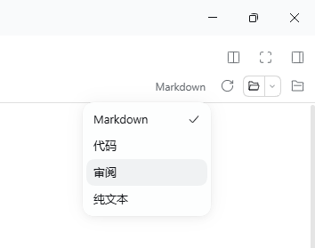

# Markdown Review Mode

[中文](#中文) · [English](#english)

**看到哪里要改，就在那里写下来 —— 看完之后交给 Agent 一次改完。**

A DeepSeek Harness plugin for reviewing AI-generated Markdown: put each
comment exactly where you read the problem, then submit them all at once for
the agent to apply in a single pass.

---

## 中文

### 为什么要做这个

AI 生成的文稿，几乎总要改。但用对话框提修改意见，有两个真实的麻烦：

- **得来回指明位置** —— "第三段那句太长""第二节顺序不对"。AI 得先猜你说的是哪一段，猜错了越改越乱；
- **换行容易误触发送** —— 意见写长了要换行，一个不小心换行键就变成发送，话还没说完就提交出去了。

所以这个插件换了个方式：**在文档里选中要修改（或要保留）的内容就地批注，看完之后一次性提交所有修改意见。**

- 读到要改的地方，选中文字写批注 —— 意见就标在这段文字上，不必再指明"是哪一段"；
- 想保留的内容选中后点 **锁定** —— 标明这段一个字都不许动；
- 整篇看完，点一次 **提交批注** —— Agent 把所有意见一起改完，逐条回执；
- 改动被程序限制在**被批注覆盖的段落**里：没有批注的地方，一个字都不动。

一句话：**像在纸上看稿子时用笔在旁边写意见，看完把整本交给助手一次改好。**

### 它怎么做到的

打开任意 `.md` 文件，右边栏顶部的渲染器下拉里会多出一个 **审阅** 选项：



选它之后：

- 文档以渲染后的样子呈现（标题、粗体、斜体、列表、表格、脚注都正常显示），点某一段则展开成源码；
- 读到要改的地方，选中文字 → 工具栏点 **批注** 写下意见，或点 **锁定** 标明这段不许动；
- 每条批注就地以下划线标在原文上，点它可以查看、编辑、删除；
- 全部看完，点 **提交批注** —— Agent 一次读取所有批注返工，改动高亮，每条意见都有回执；
- 如果你只是自己想改文字，点 **保存** 直接写回文件，不必经过 Agent。

批注被当作针对那一段文字的**指令**，不是"帮忙润色"的泛泛请求。程序会校验 Agent 的改动：没有被批注覆盖的块不许改，锁定的块必须逐字节保持原样 —— 所以它改的范围，正好是你圈出来的范围。

### 安装

**方式一：让 DSH 安装（推荐，不需要 git）**

在 DSH 的 **插件 → 添加插件** 里填入这个 tarball 地址：

```
https://github.com/Angus-169/Markdown-Review-Mode/archive/refs/heads/main.tar.gz
```

它走 HTTPS 下载，**不依赖 git** —— 没装 git 的机器也能装。仓库里已包含编译好的
`lib/`，所以装完即可用，不需要本地 Node 环境。

**方式二：用 GitHub 地址（需要 git）**

如果机器上装有 git，也可以用更短的 GitHub 简写：

```
github:Angus-169/Markdown-Review-Mode
```

完整写法也可以：`https://github.com/Angus-169/Markdown-Review-Mode.git` 或
`git+ssh://git@github.com/Angus-169/Markdown-Review-Mode.git`。

pnpm 解析这些 GitHub 地址时会调用 `git ls-remote`；如果报 `'git' 不是内部或外部命令`
或 `git ls-remote failed`，说明 git 没装或不在 PATH 里 —— 请改用方式一。

⚠️ 不要填 `git@github.com:Angus-169/Markdown-Review-Mode.git` —— 这是 git 命令行的 scp
写法，pnpm 不接受，会报 `ERR_PNPM_UNSUPPORTED_PROTOCOL`。私有仓库若要走 SSH，在本机
git 配置 `git config --global url."git@github.com:".insteadOf https://github.com/`。

**方式三：从源码构建**

```bash
git clone https://github.com/Angus-169/Markdown-Review-Mode.git
cd Markdown-Review-Mode
npm install
npm run build
npm run verify
```

然后在 **插件 → 添加插件** 里填这个目录的绝对路径。

### 配置

| 配置项 | 默认值 | 说明 |
| --- | --- | --- |
| `maxRounds` | `20` | 内存中保留的审阅轮次上限 |
| `stylesheet` | 空 | 用户样式表路径；留空时读取 `~/.dsh/review.css` |

面板样式可以用自己的 CSS 覆盖，详见 [中文档情页](docs/DETAIL.zh.md)。

### 需要什么

- DSH `0.2.2-rc.5`（依赖其 Cordis / 文档预览 / 文件系统 / 存储等服务）；
- 文档必须位于当前会话的工作目录内，且该会话挂载了文件系统服务；
- 沙箱模式为 `read-only` 时无法写回文档，审阅提交会被拒绝并说明原因。

### 已知限制

- 没有版本历史、没有整篇 diff、不能整篇回滚；只能把单个块恢复到审阅时的版本。
- 代码块、表格、HTML 块和图片按整块处理，选中其中一部分会吸附到整块。
- Agent 不能改动没有任何批注覆盖的块。
- 脚注的定义留在原文位置，不会移到文末。

---

## English

### Why this exists

AI-generated drafts almost always need changes. But writing the comments in a
chat has two real problems:

- **You have to keep pointing at the place** — "that sentence in section three
  is too long", "the order in section two is wrong". The agent has to guess
  which passage you mean, and a wrong guess makes things worse.
- **A newline becomes Send** — comments get long, you press Enter for a new
  line, and the message goes off before you have finished saying it.

So this plugin does it differently: **select the passage you want changed — or
the one you want kept — comment right there on the text, and submit all of the
comments in one go once you have finished reading.**

- Find something to change: select it and write the comment, which underlines
  that exact passage — no more "which paragraph was it".
- Something must stay as it is: select it and click **锁定** (lock) — not one
  character of that passage may change.
- Finish the whole document, then click **提交批注** once — the agent applies
  every comment together and reports back on each one.
- Changes are held by the program to **the blocks a comment covers**: a block
  with no comment is not touched at all.

In short: **like marking up a paper draft with a pen, then handing the whole
marked-up copy to an assistant to fix in one go.**

### How it works

Open any `.md` file — a **审阅** (Review) option appears in the renderer
dropdown at the top of the right sidebar, beside Markdown, Code and Plain text:


Select it and:

- The document renders as a document — headings, emphasis, lists, tables and
  footnotes display normally; click a paragraph to open its source.
- When you find something to change, select the passage → click **批注** to
  write the comment, or **锁定** to mark it as not-to-be-touched.
- Each comment underlines its passage; click one to read, edit or remove it.
- When you are done reading, click **提交批注** — the agent reads every comment,
  reworks the draft in one pass, highlights the changes, and reports one
  receipt per comment.
- If you just want to edit the text yourself, click **保存** to write it to the
  file without going through the agent.

A comment is treated as an **instruction about that passage**, not a vague
"please polish this". The plugin checks the agent's work against your marks:
blocks no comment covers must not change, and a locked block must come back
byte-identical — so the agent changes exactly what you circled.

### Installation

**Option 1 — let DSH install it (recommended, no git needed)**

In **Plugins → Add plugin**, enter this tarball URL:

```
https://github.com/Angus-169/Markdown-Review-Mode/archive/refs/heads/main.tar.gz
```

It downloads over HTTPS and **does not need git** — it works on machines with
no git installed. The compiled `lib/` is committed, so the plugin works right
after installation, with no local Node toolchain.

**Option 2 — GitHub address (needs git)**

If git is installed, the shorter GitHub shorthand works too:

```
github:Angus-169/Markdown-Review-Mode
```

The full forms work as well: `https://github.com/Angus-169/Markdown-Review-Mode.git`
or `git+ssh://git@github.com/Angus-169/Markdown-Review-Mode.git`.

pnpm calls `git ls-remote` to resolve these. If you see `'git' is not recognized`
or `git ls-remote failed`, git is missing or not on PATH — use Option 1 instead.

⚠️ Do **not** enter `git@github.com:Angus-169/Markdown-Review-Mode.git` — that
is git's scp-style form and pnpm rejects it with `ERR_PNPM_UNSUPPORTED_PROTOCOL`.
For a private repository over SSH, configure git on that machine with
`git config --global url."git@github.com:".insteadOf https://github.com/`.

**Option 3 — build from source**

```bash
git clone https://github.com/Angus-169/Markdown-Review-Mode.git
cd Markdown-Review-Mode
npm install
npm run build
npm run verify
```

Then add the directory's absolute path in **Plugins → Add plugin**.

### Configuration

| Option | Default | Meaning |
| --- | --- | --- |
| `maxRounds` | `20` | How many review rounds are kept in memory |
| `stylesheet` | empty | User stylesheet path; empty reads `~/.dsh/review.css` |

The panel's look can be changed with your own CSS; see the
[English detail page](docs/DETAIL.md).

### Requirements

- DSH `0.2.2-rc.5` (its Cordis, document-preview, filesystem and storage
  services).
- The document must live inside the session's working directory, with a
  filesystem service mounted for that session.
- Under the `read-only` sandbox mode the document cannot be written, so a
  rework submission is refused with an explanation.

### Known limitations

- No version history, no whole-document diff, no full rollback; a single block
  can be restored to its reviewed version.
- Code blocks, tables, HTML blocks and images are addressed as whole blocks; a
  selection inside them snaps to the whole block.
- The agent cannot change a block no comment covers.
- A footnote's definition stays where the source puts it, rather than moving
  to the end of the document.

---

## Development

```bash
npm install          # workspace-local npm cache; see .npmrc.example
npm run verify       # encoding, typecheck, tests, build, package checks
```

The verification pipeline checks: source encoding, TypeScript types, the unit
test suite, a clean build, and that the packaged bundle is well formed (exports
resolve, CSS classes match the decorations, the bundle is not stale).

`lib/` is committed so the plugin installs from git without a build step. Keep
it in sync: run `npm run build` after changing anything under `src/`.

## License

MIT
