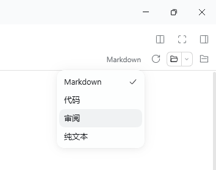

# Markdown Review Mode

Adds a review layer to Markdown documents in the right sidebar. Select text,
write a comment, submit once; the agent reads the comments, reworks the
draft, and every comment comes back answered.

## What it does

Opening a `.md` file in the right sidebar offers **审阅** in the renderer
dropdown beside the product's own Markdown view:



The review view reads like a document: the Markdown renders, the markers fade,
and a paragraph opens into its source when you click it.

Select a range and a small toolbar appears beside it. **批注** opens a field
for what is wrong with the passage, **锁定** freezes it. A comment underlines
its passage and a lock underlines it differently; clicking either opens the
annotation in place, where it can be edited or removed.

Submitting sends one message to the agent. The agent reads the annotations,
produces changes, and reports back one receipt per annotation. The panel then
shows the changed blocks and the receipt next to each comment.

## Why the comments are the instruction

The plugin treats a comment as an instruction, not as a request for help
phrased better. That is why the agent is checked by the program rather than
trusted: an edit outside the range a comment covers is refused, and a locked
range must come back byte-identical.

## Custom stylesheet

The panel is rendered by the plugin, so **your own CSS is how you make it
look the way you want** — a larger reading size, a different accent, your own
paper.

Put a file at **`~/.dsh/review.css`** and it is loaded the next time the panel
opens. To use a file somewhere else, set the plugin's `stylesheet` option to
its path; the plugin's configuration page accepts it, and the file may live
anywhere the Host may read.

The stylesheet is applied as written, so its rules reach the whole page. The
panel's own names are stable and are what you would target:

| Name | What it is |
| --- | --- |
| `markdown-review-mode-root` | the panel |
| `markdown-review-mode-toolbar` | the toolbar above the document |
| `markdown-review-mode-editor` | the document itself |
| `markdown-review-mode-floating` | the toolbar that appears over a selection |
| `markdown-review-mode-popup` | the popup that shows one annotation |
| `cm-review-strong` / `cm-review-em` / `cm-review-code` | bold, italic, inline code |
| `cm-review-h1` … `cm-review-h6` | the heading levels |
| `cm-review-marker` | the faded structural markers |
| `cm-review-highlight` / `cm-review-lock` / `cm-review-changed` | a comment, a lock, a changed block |
| `cm-review-bullet` / `cm-review-table` | a list bullet, a table |

For example, to read at a larger size:

```css
.markdown-review-mode-editor {
  font-size: 16px;
  line-height: 1.7;
}
```

## What it does not do

- No version history, no diff view, no rollback of the whole document. A
  single block can be restored to the reviewed version.
- Comments do not survive a restart of the reviewing session. Your own edits
  to the text do: they are kept outside the project and restored when the
  panel opens again.
- Code blocks, tables, HTML blocks, and images are addressed as whole
  blocks; a selection inside one of them snaps to the whole block.
- The agent cannot change a block no comment covers.
- A footnote's definition stays where the source puts it, instead of being
  moved to the end of the document.

## Requirements

The plugin needs a session whose working directory holds the document, and a
filesystem provider mounted for that session. Under the `read-only` sandbox
mode no review can be applied, because the document cannot be written.
